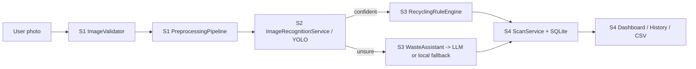

# EcoSort AI - AI-Powered Waste Sorting & Recycling Assistance

Python Compact Programming capstone · **Group 22** · FH Dortmund

# Presentation Link [YouTube] : **[Presentation video](https://youtu.be/KSPYhftteHU?is=rGCiBpW-NYKTg029)**

Upload or photograph a waste item → a trained **YOLO** model recognises it → local **German bin rules** (and an optional **AI assistant**) tell you where it goes → every scan lands in a **history and dashboard**.

| Team member | Matr. no. | Subsystem | Folder |
|---|---|---|---|
| **Deepa Halapeti** | 7225894 | 1 · Dataset & Preprocessing | [`subsystem_1_dataset_preprocessing/`](subsystem_1_dataset_preprocessing/README.md) |
| **Prasad Hule** | 7225861 | 2 · AI Image Recognition | [`subsystem_2_image_recognition/`](subsystem_2_image_recognition/README.md) |
| **Mayuresh Kumbhar** | 7226310 | 3 · Recycling Rules & Ask AI | [`subsystem_3_recycling_ai/`](subsystem_3_recycling_ai/README.md) |
| **Vijay Kathiresan** | 7226794 | 4 · Web App, Dashboard & Integration | [`subsystem_4_web_integration/`](subsystem_4_web_integration/README.md) |

Each subsystem folder has its own README with the classes, UML diagram, data storage, covered requirements and a live demo command.

---

## 1 · Quick start

### ⭐Run with Docker

The ready-made image is on Docker Hub: **`prasadhule001/ecosort-ai`**. No Python, no packages, no model download.

**Before you start:** install **Docker Desktop** (free): <https://www.docker.com/products/docker-desktop> - open it and wait until it says **"Engine running"**. You also need an **LLM API key** (KIconnect).

| Step | What to do | Command |
|:-:|---|---|
| 1 | Open a terminal (Windows: **PowerShell**; macOS/Linux: **Terminal**) | |
| 2 | Download the image (about 0.6 GB, once) | `docker pull prasadhule001/ecosort-ai:1.1` or Mac [Apple Silicon] `docker pull --platform linux/amd64 prasadhule001/ecosort-ai:1.1` |
| 3 | Start it and **pass your API key** | see below |
| 4 | Open the app in your browser | <http://localhost:5000(port)> |
| 5 | Sign in | **Sign in as: Administrator** · username `admin` · password `admin` |
| 6 | Stop the app | press `Ctrl + C` in the terminal |

**Step 3 - start the container and pass the API key** (replace `YOUR_API_KEY` with your real key, keep the quotes):

```powershell
# Windows PowerShell / macOS / Linux - the key is passed with  -e LLM_API_KEY=...
docker run --rm -p 5000:5000 -e LLM_API_KEY="YOUR_API_KEY" prasadhule001/ecosort-ai:1.1

```

Alternative - pass the key as a program argument (same result):

```powershell
docker run --rm -p 5000:5000 prasadhule001/ecosort-ai:1.1 --api-key "YOUR_API_KEY"
```

> **Where does the API key go?** Only in the `docker run` command, at the moment you start the container. It is **not** stored in the image, so everyone can use the same image with their own key.

Notes: the image is CPU-only (works on every laptop, no GPU needed); the "Go live" public-tunnel feature is disabled inside Docker; the camera button needs `localhost` or HTTPS (uploading a photo always works).

---

### Alternative: run with Python (no Docker)

```bash
python -m venv .venv
.venv\Scripts\activate            # macOS/Linux: source .venv/bin/activate
pip install -r requirements.txt
python main.py --api-key YOUR_API_KEY
```

The browser opens at <http://127.0.0.1:5000(your_port)>. **Sign in with `admin` / `admin`** (demo account) and choose **Sign in as: Administrator** on the login form.

Where does the API key go? Either of these - never into the source code:

| Way | Command |
|---|---|
| Command-line option | `python main.py --api-key YOUR_API_KEY` |
| Environment variable | PowerShell: `$env:LLM_API_KEY="YOUR_API_KEY"; python main.py` · bash: `LLM_API_KEY=YOUR_API_KEY python main.py` |

Other options: `--port 8000`, `--no-browser`, `--model path/to/best_model.pt`, `--llm-model NAME`, `--llm-base-url URL`, `--data-dir DIR`, `--help`.
Default LLM: KIconnect NRW (`https://chat.kiconnect.nrw/api/v1`, model `Qwen3.8 27B`, a vision-capable model - in our test it identified photos correctly where Mistral Small 4 did not and GPT-OSS cannot see images); any OpenAI-compatible API works via `--llm-base-url` / `--llm-model`.

**No key?** The app still runs: recognition and local rules work offline; low-confidence photos get the local rule instead of an AI review, and chat shows how to add a key.

---

## 2 · Automated tests

```bash
python testing.py            # all suites + real-model end-to-end test  (54 tests)
python testing.py --quick    # skip the real YOLO model
python testing.py --live YOUR_API_KEY   # additionally call the real LLM once
python testing.py -v         # list every test
```

Output is one table per team member:

```
[PASS] Subsystem 1 - Dataset & Preprocessing      Deepa Halapeti     13 passed
[PASS] Subsystem 2 - Image Recognition            Prasad Hule        11 passed
[PASS] Subsystem 3 - Recycling Rules & Ask AI     Mayuresh Kumbhar   11 passed
[PASS] Subsystem 4 - Web App & Integration        Vijay Kathiresan   16 passed
[PASS] End-to-end (real YOLO model)               whole team          3 passed
```

The normal tests use a *fake detector* and a *fake LLM* (dependency injection), so they need no GPU, key or internet. Raw pytest also works: `python -m pytest -v`.

Per-member live demos (no web server needed):

```bash
python -m subsystem_1_dataset_preprocessing.demo
python -m subsystem_2_image_recognition.demo
python -m subsystem_3_recycling_ai.demo [--api-key KEY]
```

---

## 3 · Project structure

```
EcoSort_AI_Final/
├── main.py                      entry point  (python main.py --api-key KEY)
├── testing.py                   automated test runner
├── Dockerfile · docker-compose.yml · .env.example · requirements.txt
├── models/best_model.pt         trained YOLO weights (7 classes)
├── sample_data/                 18 labelled demo photos
├── shared/                      EcoSortError + BaseErrorHandler (inherited by every subsystem)
├── subsystem_1_dataset_preprocessing/   Deepa   - validate, preprocess, dataset tools
├── subsystem_2_image_recognition/       Prasad  - YOLO detection, confidence, evaluation
├── subsystem_3_recycling_ai/            Mayuresh- rules, prompts, LLM client, fallback
├── subsystem_4_web_integration/         Vijay   - Flask app, SQLite, auth, dashboard, wiring
├── templates/ · static/         glassmorphism UI (HTML, CSS, JS) for desktop & phone
├── tests/                       one test file per subsystem + end-to-end
└── diagrams/                    architecture + UML overview
```

### How the pieces fit



Full UML: [`diagrams/architecture.md`](diagrams/architecture.md).

## 4 · OOP concepts demonstrated (and where)

| Concept | Example |
|---|---|
| Classes, `__init__`, attributes | every class; e.g. `ImageValidator.__init__` |
| Encapsulation (private `_x`, properties with validation) | `ImageValidator.max_bytes`, `ConfidenceFilter.threshold` |
| Getters/setters (Pythonic + UML style) | `DatasetMetadata` (`version` and `getVersion()/setVersion()`) |
| Inheritance | `EcoSortError` → per-subsystem errors; `BaseErrorHandler` → 4 handlers; `ImageStep` → steps |
| Abstract base class | `ImageStep` (`@abstractmethod apply`) |
| Polymorphism / protocols | `RuleStore` (in-memory store vs SQLite `WasteRepository`) |
| Operator overloading | `RGBStep() \| ResizeStep(320)` builds a pipeline (`__or__`) |
| Composition & dependency injection | `WasteAssistant(rules, llm, prompts)`, `create_application(config, detector, llm)` |
| Dataclasses / immutable value objects | `Detection`, `PredictionResult`, `RecyclingRule`, `GuidanceResponse` |
| Iterator / generator | `DetectionStream`, `ConfidenceFilter.filter` |
| Class/static methods | `AppConfig.from_cli`, `PreprocessingPipeline.default` |
| Exception chaining | `raise InferenceError(...) from error` |
| Repository / facade patterns | `WasteRepository`, `IntegrationController`, `DatasetManager` |

## 5 · Data storage

SQLite file `data/sortly.sqlite3` (tables `users`, `rules`, `scans`, `usage_events`) + photos in `data/camera_captures/`. In Docker this folder is `/data` (use a volume to keep it).

## 6 · Roles and permissions

Choose **Sign in as** on the login form (the choice must match the account's role). Accounts are created on the sign-up page (invitation code `pythonai`).

| Feature | Normal user | Municipality worker | Administrator |
|---|:-:|:-:|:-:|
| Assistant (photo scan, chat), Settings (threshold default **65 %**) | yes | yes | yes |
| Dashboard (charts, filters) | - | yes | yes |
| Scan history, CSV export | - | - | yes |
| Edit waste rules | - | - | yes |
| "Go live" public tunnel (local Python only) | - | - | yes |

## 8 · Team video

Add the presentation video link here before submission: **[Team presentation video](PASTE_VIDEO_LINK_HERE)**
