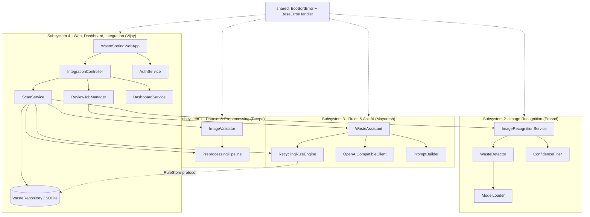
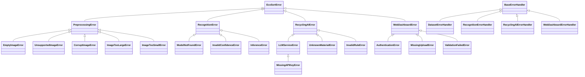
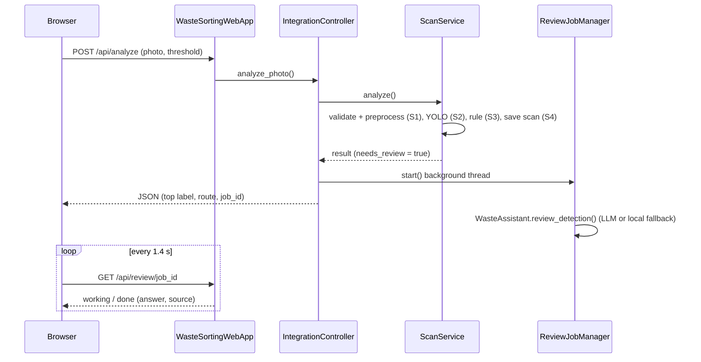

# EcoSort AI - architecture and UML overview

Detailed per-subsystem UML diagrams are in each subsystem's `README.md`. This page shows how they connect.

## Layers and dependencies

## Error-handling hierarchy

## Sequence: scanning an uncertain photo

## Mapping to the original capstone UML

The proposal's diagrams named the first-draft classes; the working project grew them as follows.

| Proposal class (Home Task 1) | Class in the final code |
|---|---|
| `DatasetManager`, `DatasetMetadata`, `DatasetSplit`, `PreprocessingPipeline` | same names, now with real logic (+ `ImageValidator`, `ImageLoader`, `DatasetStatistics`) |
| `ImageRecognitionService`, `WasteClassificationModel`, `PredictionResult`, `ImagePreprocessor` | `ImageRecognitionService`, `WasteDetector` + `ModelLoader`, `PredictionResult`, (preprocessing moved to Subsystem 1's pipeline) |
| `RecyclingGuidanceService`, `RecyclingRule`, `AskAIService`, `GuidanceResponse` | `WasteAssistant`, `RecyclingRule` + `RecyclingRuleEngine`, `OpenAICompatibleClient` + `PromptBuilder`, `GuidanceResponse` |
| `WasteSortingWebApp`, `IntegrationController`, `DashboardService`, `WasteRepository` | same names |
