# Subsystem 1 - Dataset & Preprocessing

**Owner: Deepa Halapeti (7225894)** · Goal from the PPT: *prepare a reliable, documented dataset and make sure every image that enters the system is safe and clean.*

## What runs in the real app

Every photo a user uploads passes through this subsystem **before** the model sees it:

`ImageValidator.validate_and_prepare()` → `PreprocessingPipeline.apply()` (RGB + resize ≤ 2000 px) → handed to Subsystem 2.

The dataset tools (`DatasetManager`, `DatasetSplit`, `DatasetStatistics`) prepare/document the training data and are shown with the live demo.

## Classes

| File | Class | What it does | OOP idea |
|---|---|---|---|
| `image_validator.py` | `ImageValidator` | Checks size, format (JPEG/PNG/WebP), pixels, readability; fixes phone rotation | Encapsulation (validated properties), exception chaining |
| `image_loader.py` | `ImageLoader` | Reads an image file from disk | Single responsibility |
| `preprocessing_pipeline.py` | `ImageStep` (abstract) | Contract: `apply(image) -> image` | **Abstract base class** |
| | `RGBStep`, `ResizeStep` | Concrete steps | **Inheritance, polymorphism** |
| | `PreprocessingPipeline` | Runs steps in order; `a \| b` builds a pipeline | **Composite pattern, operator overloading** |
| `dataset_record.py` | `DatasetRecord` | One manifest row (file, label, source, checksum, split) | Dataclass |
| `dataset_metadata.py` | `DatasetMetadata` | Source / licence / version of the data | Properties + UML-style `getX/setX` |
| `dataset_statistics.py` | `DatasetStatistics` | Class counts and imbalance ratio | Frozen dataclass, `@classmethod` factories |
| `dataset_split.py` | `DatasetSplit` | Reproducible train/val/test split, leakage check | Encapsulation, seeded RNG |
| `dataset_manager.py` | `DatasetManager` | Facade: load → validate (corrupt/duplicates) → split → manifest CSV | **Composition, dependency injection** |
| `exceptions.py` | `PreprocessingError` + 6 subclasses, `DatasetErrorHandler` | Specific errors + safe messages | **Inheritance hierarchy** |

## UML class diagram

```mermaid
classDiagram
class ImageStep { <<abstract>> +apply(image) Image }
class RGBStep { +apply(image) }
class ResizeStep { -max_side +apply(image) }
class PreprocessingPipeline { -steps +apply(image) +default() +to_normalized_array(image) }
class ImageValidator { -max_bytes -max_pixels -min_side +validate_and_prepare(data) Image }
class ImageLoader { +load(path) +load_bytes(path) }
class DatasetManager { -dataset_path +load_dataset() +validate_dataset() +split_dataset() +export_manifest(csv) }
class DatasetMetadata { -source -license -version +to_dict() }
class DatasetSplit { -train_ratio -validation_ratio -seed +split(records) +has_leakage() }
class DatasetStatistics { +total_images +class_counts +imbalance_ratio +from_folder() +report() }
class DatasetRecord { +filename +label +source +checksum +split }
class DatasetErrorHandler { +handle(error) ErrorResponse }
ImageStep <|-- RGBStep
ImageStep <|-- ResizeStep
ImageStep <|-- PreprocessingPipeline
PreprocessingPipeline o-- ImageStep
DatasetManager *-- ImageValidator
DatasetManager *-- ImageLoader
DatasetManager *-- DatasetSplit
DatasetManager *-- DatasetMetadata
DatasetManager *-- PreprocessingPipeline
DatasetManager ..> DatasetRecord
DatasetManager ..> DatasetStatistics
```



## Data storage (PPT)
Image folders; the **CSV manifest** (`DatasetManager.export_manifest`) stores label, source, split and SHA-256 checksum per image. Sample data: `../sample_data/` (18 labelled images; label = second part of the file name `source__Label__name.jpg`).

## Requirements covered
Validate type/readability · resize · normalise (`to_normalized_array`) · split train/val/test · detect corrupt/duplicate images · class counts & imbalance · manifest export · prevent leakage · safe handling of corrupt files · JPG/PNG/WebP · protect uploads (not trusted, size-limited).
**Honest limits:** augmentation and training-time data collection were done outside this app during model training; the licence text in `DatasetMetadata` must be confirmed from the original dataset pages before publishing.

## Try it
```bash
python -m subsystem_1_dataset_preprocessing.demo      # live demo (no key, no model)
python -m pytest tests/test_subsystem_1_dataset.py -v # 13 tests
```

## Debugging tips
* Photo rejected? Read the server log line `[dataset_preprocessing] CODE: detail` - the `detail` is the technical reason.
* `UNSUPPORTED_IMAGE` = not JPEG/PNG/WebP; `IMAGE_TOO_SMALL` = side < 80 px.
