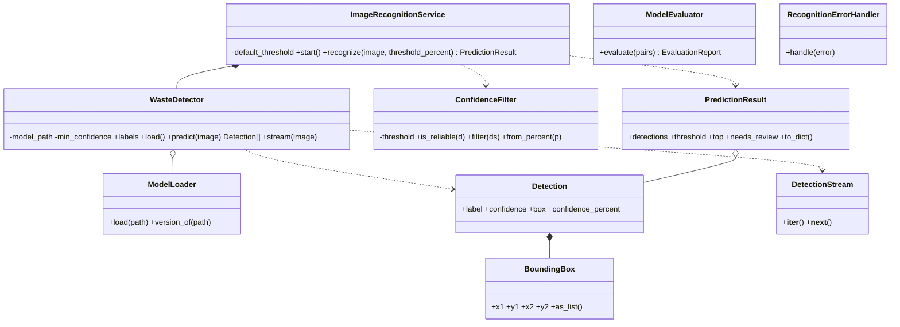

# Subsystem 2 - AI Image Recognition

**Owner: Prasad Hule (7225861)** · Goal from the PPT: *classify waste images and expose confidence and evaluation results.*

## What runs in the real app

`ImageRecognitionService.recognize(image, threshold)` is called for every scan. It runs the trained **YOLO** model (`models/best_model.pt`, 7 classes: Biomuell, Glass, Metal, Papier, Plastic, Sondermuell, Textile_Trash), sorts detections by confidence and returns a `PredictionResult`. If the best confidence is below the user's slider value, `needs_review = True` and Subsystem 3 asks the AI for a second opinion.

## Classes

| File | Class | What it does | OOP idea |
|---|---|---|---|
| `model_loader.py` | `ModelLoader` | Loads + caches the YOLO weights; reports model version | Dependency injection (tests pass a fake loader) |
| `detector.py` | `WasteDetector` | Runs the model on an image → `list[Detection]`; thread-safe, lazy loading | Composition, `Lock` |
| | `DetectionStream` | Iterator over detections | **Iterator protocol** (`__iter__`/`__next__`) |
| `detection_models.py` | `BoundingBox`, `Detection` | Box + label + confidence | Frozen dataclasses (value objects) |
| | `PredictionResult` | Everything Subsystem 4 needs: detections, `top`, `needs_review`, threshold | Computed properties |
| `confidence_filter.py` | `ConfidenceFilter` | Is a detection reliable? `from_percent()` clamps 10–95 % | Validated property, **generator** |
| `recognition_service.py` | `ImageRecognitionService` | Single entry point used by the web layer | **Abstraction / facade** |
| `model_evaluator.py` | `ModelEvaluator`, `EvaluationReport` | Accuracy, precision, recall, F1 per class | Pure-Python metrics |
| `exceptions.py` | `RecognitionError` + 3 subclasses, `RecognitionErrorHandler` | `ModelNotFoundError`, `InvalidConfidenceError`, `InferenceError` | Inheritance, `raise ... from` |

## UML class diagram



## Data storage (PPT)
The model artifact lives in `models/best_model.pt` (`ModelLoader.version_of` shows name + size). Every prediction is saved by Subsystem 4 in the SQLite `scans` table (label, confidence, timestamp, image path).

## Requirements covered
Accept uploaded image · predict supported category · return confidence · top prediction + alternatives (UI shows "Also considered") · low-confidence warning · load saved model · handle model-loading errors · evaluate accuracy/precision/recall/F1 · save metadata · works on CPU · inference code testable (fake detector) · model replaceable (`ImageRecognitionService` hides YOLO).

## Try it
```bash
python -m subsystem_2_image_recognition.demo      # runs the REAL model on 18 samples + metrics
python -m pytest tests/test_subsystem_2_recognition.py -v   # 11 tests
```
Result of the demo on the shipped samples: **18 / 18 correct** (these are examples, not a held-out test set - say so when presenting).
