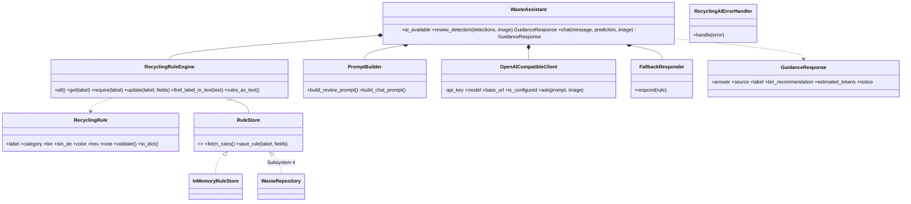

# Subsystem 3 - Recycling Rules & Ask AI

**Owner: Mayuresh Kumbhar (7226310)** · Goal from the PPT: *translate predicted categories into disposal guidance; rule-based baseline, LLM optional.*

## What runs in the real app

* Confident prediction → `RecyclingRuleEngine.get(label)` gives the bin, German name, colour and instructions (no AI needed).
* Unsure prediction → `WasteAssistant.review_detection()` sends the photo + predictions + the rules to the LLM. **If the key is missing or the API fails, the local rule is returned instead** (`source = "local-fallback"`, with a notice).
* Chat → `WasteAssistant.chat()`.
* Admins edit rules in the browser (`/admin/rules`) → stored in SQLite → used immediately (no code change).

## Classes

| File | Class | What it does | OOP idea |
|---|---|---|---|
| `recycling_rule.py` | `RecyclingRule` | One rule (label, bin, German bin, colour, note); `validate()`, `to_dict()`, `from_dict()` | Dataclass, alternative constructor |
| `default_rules.py` | `DEFAULT_RULES` | Seed data for the 7 classes | - |
| `rule_store.py` | `RuleStore` (Protocol), `InMemoryRuleStore` | Where rules live; SQLite repository (Subsystem 4) fits the same protocol | **Polymorphism / duck typing** |
| `recycling_rules.py` | `RecyclingRuleEngine` | Look up, list, edit rules; find a rule named in AI text | Dependency injection |
| `prompt_builder.py` | `PromptBuilder` | Builds review and chat prompts | Single responsibility |
| `llm_client.py` | `OpenAICompatibleClient` | Calls any OpenAI-style API (KIconnect), encodes photos; key never printed | Encapsulation, `__repr__` hides secret |
| `fallback_responses.py` | `FallbackResponder` | Text from a rule when AI is unavailable | - |
| `guidance_response.py` | `GuidanceResponse` | Answer + source (`llm` / `local-fallback`) + tokens + notice | Frozen dataclass |
| `ai_assistant.py` | `WasteAssistant` | Orchestrates rules → LLM → fallback | **Composition** |
| `exceptions.py` | `RecyclingAIError`, `LLMServiceError`, `MissingAPIKeyError`, `UnknownMaterialError`, `InvalidRuleError`, `RecyclingAIErrorHandler` | Specific errors | Inheritance (`MissingAPIKeyError` is a `LLMServiceError`) |

## UML class diagram



## Data storage (PPT)
SQLite table `rules` (label, category, bin, bin_de, colour, hex, note, `updated_at`) - owned by Subsystem 4's repository, edited through this subsystem's engine. The seed values are in `default_rules.py`.

## API key (important)
The key is **never** in source code. It comes from `--api-key` or the `LLM_API_KEY` environment variable, and is never printed (`repr(client)` shows `api_key='set'`). Without a key the app still sorts waste with local rules ("Keep paid LLM optional").

## Requirements covered
Category → guidance · preparation text · bin recommendation · configurable rules · explain why · answer disposal questions (LLM) · update rules without code · warn when unknown (fallback text) · distinguish AI text from rules (`source` badge) · protect API keys · LLM optional.
**Honest limits:** rules are one set for Germany/Dortmund; per-city rules, source URLs and review dates (PPT items) are not implemented - mention as future work.

## Try it
```bash
python -m subsystem_3_recycling_ai.demo                 # local fallback
python -m subsystem_3_recycling_ai.demo --api-key KEY   # real LLM answer
python -m pytest tests/test_subsystem_3_recycling_ai.py -v   # 11 tests
```

## Debugging tips
* Server log shows `[recycling_ai] LLM_UNAVAILABLE: <real reason>` (401 = wrong key, DNS/timeout = no internet, 404 = wrong `--llm-model`).
* Wrong bin shown after an admin edit? Check `GET /admin/rules` - the engine reads the DB on every call.
