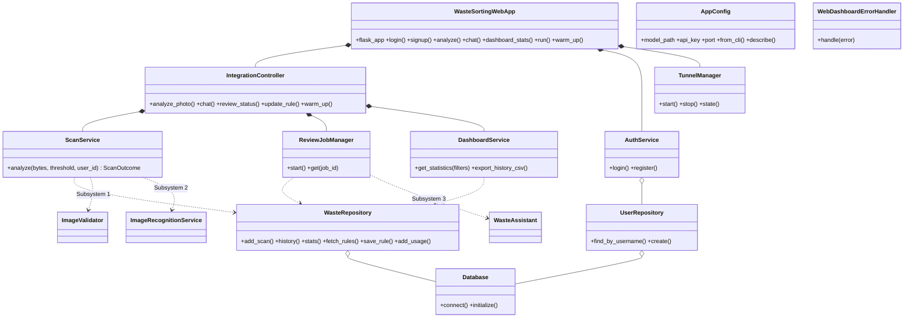

# Subsystem 4 - Web App, Dashboard & Integration

**Owner: Vijay Kathiresan (7226794)** · Goal from the PPT: *connect scanning, guidance, history and analytics in one usable application.*

## What this subsystem does

It is the **integration layer**: it builds every object of the other three subsystems (`application_factory.py` - the *composition root*), exposes the HTTP routes, stores data in SQLite and renders the pages (Assistant, Settings, Dashboard, History, Rules, Login/Sign-up) with the glassmorphism UI in `../templates` and `../static`.

## One scan, step by step

```
Browser --POST /api/analyze--> WasteSortingWebApp.analyze()
   -> IntegrationController.analyze_photo()
        -> ScanService.analyze()
             1 ImageValidator          (Subsystem 1)
             2 PreprocessingPipeline   (Subsystem 1)
             3 save photo to /data/camera_captures
             4 ImageRecognitionService (Subsystem 2)  -> PredictionResult
             5 RecyclingRuleEngine     (Subsystem 3)  -> bin rule
             6 WasteRepository.add_scan (SQLite)
        -> if unsure: ReviewJobManager.start()  -> WasteAssistant (Subsystem 3) in a thread
   <-- JSON  (browser polls /api/review/<job_id> for the AI answer)
```

## Classes

| File | Class | What it does | OOP idea |
|---|---|---|---|
| `app_config.py` | `AppConfig` | All settings: CLI args > env vars > defaults; key never printed | Dataclass, `@classmethod` factory |
| `application_factory.py` | `create_application()` | Creates and wires every object | **Dependency injection** (tests pass fakes) |
| `waste_sorting_web_app.py` | `WasteSortingWebApp` | Flask app as a class: routes, login check, JSON error mapping | Encapsulation, methods as routes |
| `integration_controller.py` | `IntegrationController` | Use cases: scan, chat, review status, edit rule | Facade / "no web code, no SQL" |
| `scan_service.py` | `ScanService`, `ScanOutcome` | The scan workflow across subsystems 1-3 | Composition |
| `review_jobs.py` | `ReviewJobManager` | Background AI review with status polling | Threads + `Lock` |
| `dashboard_service.py` | `DashboardService` | Statistics for charts + CSV export | - |
| `database.py` | `Database` | SQLite connections + schema + seeding | `ClosingConnection` subclass |
| `waste_repository.py` | `WasteRepository` | All SQL for rules, scans, usage, stats | **Repository pattern**, satisfies `RuleStore` |
| `user_repository.py` | `UserRepository`, `AuthService` | Accounts (hashed passwords), login, sign-up rules | Separation of concerns |
| `tunnel_manager.py` | `TunnelManager` | Optional Cloudflare "Go live" (disabled in Docker) | State machine |
| `exceptions.py` | `WebDashboardError` + 7 subclasses, `WebDashboardErrorHandler` | Safe HTTP errors | Inheritance |

## UML class diagram



## Roles (enforced on pages AND API)
Admin: everything · Municipality worker: assistant + dashboard · Normal user: assistant + settings. History, CSV export, rule editing and the tunnel are admin-only (`WasteSortingWebApp._require_role`). The login form's "Sign in as" must match the stored role (`AuthService.login`).

## Data storage (PPT) - SQLite `data/sortly.sqlite3`

| Table | Holds |
|---|---|
| `users` | username, **hashed** password, role (user / municipality / admin) |
| `rules` | recycling rules (edited by admins) |
| `scans` | image path, label, confidence, bin, source (local / llm / local-fallback), tokens, city, time |
| `usage_events` | AI calls and token estimates per user |

## Routes

Pages: `/login` `/signup` `/` `/dashboard` `/history` `/admin/rules` · API: `POST /api/analyze`, `POST /api/chat`, `GET /api/review/<id>`, `GET /api/photo/<name>`, `GET /api/dashboard/stats`, `GET /api/dashboard/export.csv`, `POST /api/admin/rules`, `/api/tunnel/*`, `GET /health`.

## Requirements covered
Home/Scan/Ask AI/Dashboard/History/Rules pages · upload + camera · bin + instructions · history · summary by category · CSV export · confidence + uncertainty shown · helpful errors, loading states · responsive layout (desktop + phone) · UI separated from logic · no stack traces (error handlers) · documented setup · camera only claimed when built.
**Honest limits:** "impact estimates" use clearly marked *sample data*; city selection is stored (`city` column, default Dortmund) but there is no city picker yet; default `admin/admin` account is for demos only (change with `SORTLY_USERNAME` / `SORTLY_PASSWORD`).

## Try it
```bash
python -m pytest tests/test_subsystem_4_web.py -v     # 16 tests
python main.py --api-key YOUR_KEY                     # the full app
```

## Debugging tips
* Server prints the active settings at start (`describe()`, key shown only as `set`/`missing`).
* A route returns a JSON `code` (e.g. `IMAGE_TOO_SMALL`) - search that code in the `exceptions.py` of each subsystem.
* Inspect data: open `data/sortly.sqlite3` with any SQLite viewer.
* Camera button needs HTTPS or `localhost`; over plain LAN HTTP browsers block it (upload still works).
